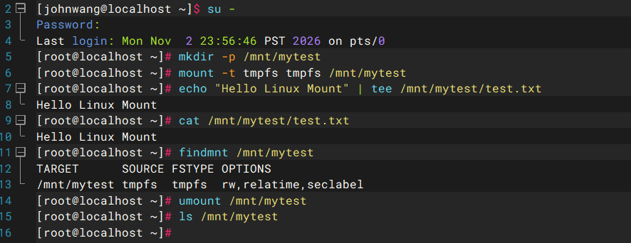
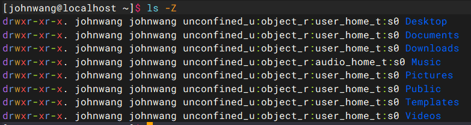

# Linux零基础网课入门笔记

## 第一章   Linux基础命令

### 1.1   Linux的目录结构

**Linux的目录结构是一个树型结构**

Windows可以有多个盘符，比如C盘，D盘，E盘

Linux只有一个根目录 **/**，**所有文件都在根目录下面**

- Windows文件路径示例：C:\Users\21290\Desktop\test.txt
- linux的文件路径示例：**/user/local/hello.txt**

#### 1.1.1   Linux目录结构详解

- /bin **[常用]**

是Binary的缩写，主要存放系统启动、修复和基本操作所需要的用户命令

- /sbin **[常用]**

s就是System的意思，主要存放系统管理和维护相关的系统程序

- /home **[常用]**

存放普通用户的主目录，在Linux中每个用户都有一个自己的目录，一般该目录名是以用户的账号命名

- /root **[常用]**

Linux 超级用户 root 的主目录，**不是所有系统管理员的统一主目录**

- /lib **[常用]**

主要存放系统启动和运行基本命令所需要的共享库，以及内核模块，它们为程序运行和内核功能扩展提供支持

- /lost+found

通常存在于 ext2/ext3/ext4 等文件系统的根目录中，用于存放文件系统检查和修复过程中恢复出来的孤立文件或数据，正常情况下通常为空

> 这也是一个挺有意思的目录，以后学习文件系统恢复、磁盘故障排查时还会遇到它

- /etc **[常用]**

主要用于存放系统级配置文件，包括用户、网络、服务、软件等配置

> /etc/shadow 就在这里，它保存用户密码哈希等敏感账户信息

- /usr **[常用]**

通过包管理器安装的软件，其可执行程序、共享库和公共资源通常位于 /usr 体系下，而配置文件、运行数据和日志则可能分别位于 /etc、/var 等目录

> 能帮助你理解一个软件安装之后为什么会分布在多个目录中

- /boot **[常用]**

 存放 Linux 系统启动所需的重要文件，常见的有内核镜像、initramfs 镜像以及 GRUB 引导配置等

> 学习 Linux 启动流程、内核加载、引导故障排查时非常重要

- /proc **[不能动]**

是 Linux 内核提供的虚拟文件系统（procfs），主要用于向用户空间提供进程信息、内核状态、系统资源信息和部分运行时参数接口，读取其中的文件，可以获取系统当前的运行信息

> 偏向于进程、内核和系统运行状态的信息，例如 CPU 信息、内存统计、进程动态、网络状态等

- /srv **[不能动]**

用来存放系统服务（如网站、FTP、数据库等）对外提供数据的目录

- /sys **[不能动]**

是 Linux 提供的 sysfs 虚拟文件系统，主要向用户空间展示内核对象及其属性，尤其是设备、驱动、总线和电源管理等信息，部分接口允许通过读写属性来调整内核或设备行为

- /tmp

用于存放临时文件，例如程序运行过程中产生的临时数据，文件可能在系统重启或定期清理时被删除，不适合存放需要长期保留的重要数据

- /dev 

是 Linux 的设备文件目录，存放用于访问设备驱动的特殊文件，用户程序可以通过这些设备文件与磁盘、终端等设备进行交互，其中既有物理设备对应的节点，也有虚拟设备节点

> 很值得你以后深入学习，因为它涉及 Linux 的设备管理和 I/O 机制

- /media **[常用]**

通常用于挂载可移动存储设备，例如 U 盘、移动硬盘和光盘，在带有桌面环境的 Linux 系统中，设备可能被自动识别并挂载到该目录下，具体行为取决于系统配置

- /mnt **[常用]**

系统提供该目录是为了让用户临时挂载别的文件系统的，我们可以将外部的存储挂载在/mnt/上，然后进入该目录就可以查看里的内容了

- /opt

用于存放附加应用软件包，常见于独立部署的第三方软件，不同软件通常使用各自的子目录保存程序及相关资源

- /usr/local **[常用]**

用于存放管理员在本机自行安装和管理的软件，例如通过源码编译安装的程序，许多构建系统默认使用 /usr/local 作为安装前缀，但实际位置取决于构建配置

- /var **[常用]**

用于存放系统运行期间产生的可变数据，包括日志、缓存、程序状态、队列数据等

排查 Linux 系统故障时，/var/log 是重要的日志排查入口，也可以使用 journalctl 查询 systemd 日志

- /run (这个目录对运维工程师很重要)

用于存放系统运行期间产生的临时运行数据，如运行时套接字、PID、服务状态

与 /var 的区别在于，它的核心概念是当前运行状态，而 /var 的核心概念是可变数据


> 尝试回答三个问题：
>
> 1.这个目录里的内容是谁创建和维护的？
>
> 2.这个目录的数据是真实存储在磁盘上，还是由内核动态提供的？
>
> 3.如果这个目录出现异常，可能影响系统的哪个功能？


——————————————————————————————————————————————————

> 警告，初学者可只花十几秒看一眼 /selinux ，知道这就是个跟安全有关的文件目录即可，分割线中的内容涉及Linux网络安全，这是快速入门Linux常规操作所不需要的，不感兴趣直接略过就好

- /selinux **[security-enhanced linux]**

> 这玩意有点意思哦，感觉会是一个不得了的攻击切入点，当然如果在现实操作里可行度很低的话，那就当我异想天开吧，特地用线划分并注释的原因是，了解这个目录时，它的特性让我眼前一亮，说实话初学者真没必要详细了解这一部分，但我当时实在是太感兴趣了，遂记录

先了解一个词，**挂载**

**挂载（Mount）是Linux文件系统中，最基础，最重要的概念之一**

假设你的电脑有一块新的硬盘：

```
/dev/sdb1
```

这块硬盘已经有文件系统，并且存放了一些文件

但在Linux中，即使你将硬盘连接到电脑上，也不代表你可以直接通过普通目录访问里面的文件

**你需要执行挂载操作**

比如：

```
sudo mount /dev/sdb1 /mnt/data
```

这条命令做了什么？

- /dev/sdb1：要挂载的设备或文件系统
- /mnt/data：挂载点，也就是准备连接它的目录
- mount：执行挂载操作

挂载完成后，你就可以通过：

```
cd /mnt/data
ls
```

查看硬盘中的文件了

挂载之前：

```
/
├── home
├── etc
├── var
└── mnt
    └── data
```

挂载之后：

```
/
├── home
├── etc
├── var
└── mnt
    └── data
        ├── document.txt
        ├── picture.jpg
        └── video.mp4
```

现在，你通过 /mnt/data 访问的内容，实际上来自 /dev/sdb1 对应的文件系统

**注意：这里不是把文件复制到了 /mnt/data，而是让这个目录成为访问另一个文件系统的入口**

**而且挂载的对象不一定是一块硬盘，也可以是一种由内核提供的特殊文件系统**

来一起动手操作一下吧 ！😋😋😋

建议先用 tmpfs 做实验，不需要额外硬盘，也不会格式化任何磁盘

第一步：创建挂载点

```
sudo mkdir -p /mnt/mytest
```

第二步：挂载tmpfs

```
sudo mount -t tmpfs tmpfs /mnt/mytest
```

第三步：在里面创建文件

```
echo "Hello Linux Mount" | sudo tee /mnt/mytest/test.txt
```

第四步：查看文件

```
cat /mnt/mytest/test.txt
```

第五步：查看挂载信息

```
findmnt /mnt/mytest
```

第六步：卸载

```
sudo umount /mnt/mytest
```

第七步：查看创建的文件是否存在

```
ls /mnt/mytest
```

你会发现刚刚创建的文件消失了，原因是 tmpfs 是临时文件系统，卸载后它所承载的数据不会继续保留



其中查看挂载信息时，返回的参数：

- TARGET：挂载点的路径
- SOURCE：挂载来源，文件系统来自哪里
- FSTYPE：文件系统类型
- OPTIONS：挂载选项


了解完挂载过后，我们继续之前的旅途

这个时候再涉及另一个概念：**selinuxfs（SELinux 文件系统）**

SELinux 会通过一种特殊的伪文件系统向用户空间提供内核中的 SELinux 配置和活动策略等信息

常见挂载位置是：

```
/sys/fs/selinux
```

在一些较老的系统或特定配置中，也可能挂载在：

```
/selinux
```

**它不是普通磁盘目录，而是内核与用户空间交互的接口**

例如，你可以通过它暴露的信息，了解 SELinux 当前的运行状态和策略信息

说人话就是，**Linux 系统强制访问控制（MAC）机制的“运行状态监视器”**

> 是不是又头大了？这他妈初学者读这句话都感觉费力，什么叫他妈的Linux 系统强制访问控制（MAC）机制？明明都是中文，组合在一起，老子怎么看不懂呢

要理解这个**强制访问控制（MAC，Mandatory Access Control）**，就先了解一下这位的死对头，也就是**自主访问控制（DAC，Discretionary Access Control）**

传统的Linux权限就是DAC，太自由了，谁创建了文件，谁就是文件的主人，主人想给谁看就可以给谁看（用 chmod 改权限，用 chown 改属主）

那万一，黑客哥们用了一些奇奇怪怪的手段给文件植入了木马，那黑客就成为了第二个主人，随意翻阅文件内容，逛文件夹像进出公共厕所一样简单，那就完蛋了啊

这个时候聪明人就开始使用MAC来预防这种情况，系统不仅要看你是谁（DAC），还要看**统一颁发的安全标签**，就算有root权限，没有对应的安全标签，也不能进行访问，因为这是**系统强制限制，没有任何商量的余地**

MAC机制的工作原理如下：

1.打标签

**安全上下文（Security Context）是MAC里最核心的概念**

在终端输入 `ls -Z `（查看文件的安全上下文）



其中这个**unconfined_u:object_r:user_home_t:s0**就是安全上下文

一共四个组成部分：

- 用户身份：unconfined_u，意思是不受控制的用户
- 角色：object_r（表示这是文件或目录的角色，如果是进程，这里通常是 system_r）
- 类型（Type）：user_home_t（**这是最核心、最重要的部分！** 在绝大多数策略中，系统就是靠这个“类型”来决定能不能访问的）
- 敏感级别：MLS/MCS 安全级别或范围

**其中，为什么类型是最重要的？**

SELinux 最重要的访问控制机制之一叫做，**TE（Type Enforcement，类型强制）**

理解两个词就行：

- Subject（主体）：发起操作的一方，通常是进程
- Object（客体）：被操作的一方，例如文件、目录、套接字等

例如：

```
主体：Nginx 进程
类型：httpd_t

客体：系统密码文件
类型：shadow_t
```

SELinux 策略可以规定：

```
httpd_t 可以读取某些网页文件
httpd_t 不允许读取 shadow_t 文件
```

你可以把这部分理解成：

**安全上下文负责给主体和客体贴上身份标签，策略负责规定这些标签之间允许发生什么操作**


2.规则匹配（策略库）

系统内核里加载了一套庞大的**安全策略**（Policy）。这套策略由安全专家预先编写好，规定了 “什么类型的主体，能访问什么类型的客体”


3.内核实时拦截

SELinux 有一个非常重要的组件：

**AVC（Access Vector Cache，访问向量缓存）**

它的作用是缓存访问控制决策，避免每次访问都重新进行完整的策略计算

你可以把实际过程简化理解为：

- Nginx 进程尝试访问某个文件
- 内核通过 LSM 安全检查机制触发 SELinux 检查
- SELinux 根据主体、客体、安全上下文及请求的操作类型进行权限判断
- AVC 检查是否已经缓存相应的访问决策
- 根据策略结果允许或拒绝操作
- 对于需要审计的拒绝行为，生成相应的审计记录


在 Linux 中，实现 MAC 机制的并不是只有一种技术，最著名的有两个：

- SELinux（Security-Enhanced Linux）：由美国国家安全局（NSA）主导开发，极其严格，功能最强大，是红帽系（CentOS/RHEL）的默认安全模块
- AppArmor：相对轻量级，配置更简单，通过路径来限制程序。是 Ubuntu、SUSE 的默认安全模块

**MAC不是绝对安全的**，**永远没有绝对的安全！**

1.策略配置的复杂性和人为失误

MAC 的核心是“策略”（Policy），而写出完美无缺的策略是极其困难的

- 配置过宽：管理员为了图省事，或者因为软件频繁报错，可能会给某个程序（比如 Web 服务器）赋予过大的权限范围，一旦这个程序被攻破，黑客就能利用这些过宽的权限进行破坏
- 配置过严：如果策略太死板，正常的业务跑不起来，管理员为了恢复业务，可能会直接选择关闭 MAC或者开启宽容模式（Permissive）只记录不拦截，这实际上等于让 MAC 失效

2.零日漏洞与内核级攻击

MAC 是 Linux 内核的一部分，如果攻击者找到了 Linux 内核本身的提权漏洞（零日漏洞 0day），或者直接利用内存破坏漏洞（如缓冲区溢出），他们就有可能在内核层面绕过甚至篡改 MAC 的策略，当内核本身被黑客控制时，MAC 设定的规则也就成了摆设

3.内部策略缺陷与逻辑漏洞

MAC 只能控制程序按规则办事，如果系统自带的某个合法程序本身就存在逻辑漏洞（比如一个允许执行系统命令的合法服务），黑客就可能利用这个合法程序（在 MAC 的允许范围内）进行越权操作，这被称为合法滥用或白名单绕过

4.侧信道攻击（Side-Channel）

MAC 主要控制直接访问，但防不住侧信道攻击，例如黑客无法直接读取某个文件，但他们可能通过探测 CPU 的缓存时间差、内存的访问延迟，或者电源功耗的变化，间接推断出敏感数据的内容

5.供应链攻击

如果你安装的第三方软件包（或者你自己编译的源码）在下载时就被人植入了后门，并且你在配置 MAC 策略时，为了让它正常运行而赋予了它极大的信任，那么 MAC 也会对这个软件放行


> 我觉得你现在可以开始培养一种习惯：
>
> 每遇到一个 Linux 系统组件，都尝试从三个角度研究它
>
> - 基础原理，它是什么？解决什么问题？怎么工作？
> - 实际配置，它在哪里？如何查看？如何配置？如何排错？
> - 安全研究，它能防御什么？有什么弱点？配置错误会造成什么后果？攻击者可能如何利用？
>
> 成为一位优秀的网络安全从业者，这条路必定不会太顺利，要深入人心的知识太多了，能不能熬住这份孤独，能不能沉下心来，都是未知数
>
> 我希望你能乐在其中，用这些知识去创造属于自己的life time


——————————————————————————————————————————————————


### 1.2   Linux命令入门

#### 1.2.1   Linux命令基础

Linux命令的通用格式：

```
command [-options] [parameter]
```

- command 命令本身
- -option 命令的一些选项，可以控制命令的行为细节，非必填
- parameter 命令的参数，多数用于命令的指向目标等，非必填

比如

```
ls -l /home/narukami
```

**ls**是命令本身，**-l**是选项，**/home/narukami**是命令的指向目标

意思为，以列表的形式显示/home/narukami目录里的内容

#### 1.2.2   ls命令入门

ls命令的作用就是列出目录下的内容，语法细节如下：

```
ls [-a -l -h] [linux路径]
```

当不使用选项和参数时，表现形式如下


Q：直接输入ls命令，列出当前目录下的内容，当前目录是哪一个目录？

A：**HOME目录**，每个Linux操作系统用户在Linux系统中的个人账户目录，路径为**/home/用户名**


#### 1.2.3   ls命令的参数和选项

##### ls -a命令

**all的意思，列出全部文件，包含隐藏的文件/文件夹（以 . 开头的，在Linux里就是隐藏文件，能自动隐藏）**


Q：最左边 . 和 .. 什么意思？

A：在 Linux 的每一个目录里，都**默认自带**这两个特殊的隐藏目录

- **. （单个点）**：代表**“当前目录”**，比如你想运行当前目录下的某个脚本，可以用 `./脚本名`，这里的 `.` 就是告诉系统“在当前目录找”
- **.. （两个点）**：代表**“上一级目录（父目录）”**，比如你现在在 `/home/johnwang` 目录下，输入 `cd ..`，你就会退回到 `/home` 目录

Q：为什么有的蓝，有的白？

A：这是因为你的 CentOS 终端设置了**颜色别名（Color Aliases）**，不同的颜色代表不同类型的文件，**蓝色的字**通常代表**目录（文件夹）**，**白色的字**通常代表**普通文件**


##### ls -l命令

**以列表（竖向排列的形式）展示内容，并展示更多信息**


- total 0：当前目录下所有文件和文件夹（包含隐藏文件）实际占用磁盘空间为0
- d：代表文件类型，d表示这是一个**目录（Directory/文件夹）**，如果是 **-** ，则为普通文件
- rwx：代表**文件所有者（Owner）**的权限，r是read，w是write，x是execute，分别代表读，写，执行，说明johnwang对这个文件夹有读、写、执行的权限
- r-x：代表**所属组（Group）**的权限，说明同组用户只有读和执行权限，没有写权限（缺少w）
- r-x：代表**其他用户（Others）**的权限，说明同组用户只有读和执行权限，没有写权限（缺少w）
- **r-x后面那个点看见没**，表示这个文件/目录打上了安全标签，那玩意是**安全上下文（SELinux）**标识，如果是+号通常代表有 ACL 权限
- 2：代表这个目录下包含的**子目录数量**
- johnwang：表示这个文件夹归属于哪个用户，**所有者（Owner）**
- johnwang：表示这个文件夹属于哪个用户组，Linux 在创建用户时，默认会创建一个同名用户组
- 6：代表文件占用的空间大小（单位是字节 bytes），对于 Linux 的文件夹来说，这个数字通常不是里面文件的总大小，而是记录这个文件夹结构本身（元数据）所占用的空间。所以空文件夹通常也有 6 或 4096 字节
- Oct：最后修改时间（Month）
- 27：最后修改时间（Day）
- 00:32：最后修改时间（Time）


##### ls命令选项的组合使用

语法中的选项是可以组合使用的，比如-a和-l可以组合


##### ls -h命令

- 以易于阅读的形式，列出文件的大小，如K，M，G


- 必须要搭配 -a ，-l 来使用


